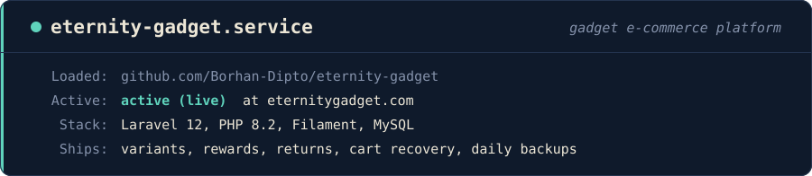

<p align="center">
  
</p>

<p align="center">
  <a href="https://eternitygadget.com"></a>
  
  
  
  
</p>

# Eternity Gadget

**Eternity Gadget** is a full e-commerce platform for a gadget and accessories shop in Bangladesh. Customers get a fast, Bangla-friendly storefront; the team gets a powerful **Filament** admin panel to run products, orders, marketing and customer service.

## ✨ Features

**Storefront**
- Home, category, product, search, compare and wishlist pages
- Product options and variants — picking a colour or model shows that exact photo
- Cart, checkout with delivery areas, free-delivery progress bar and a sticky order button
- Customer accounts with social login, order history, reward points and gift cards
- Product reviews and return requests
- Shop in **Bangla or English**, with self-hosted Inter + Hind Siliguri fonts
- Modern frosted-glass design and friendly error pages

**Admin panel (Filament)**
- Products, categories, device models, product options and inventory adjustments
- Orders with status filters, professional PDF invoices and order badges
- Coupons, gift cards, reward points and shipping methods
- Homepage sections, sliders, menus, pages and site settings — no code changes needed
- Newsletter subscribers, contact messages and WhatsApp contact buttons
- Audit logs and **2-step admin login**
- Product import / export

**Automation**
- Abandoned-cart recovery
- Low-stock alerts
- Automatic confirmation of pending orders
- Daily database backups and error alerts

**Marketing & SEO**
- Meta Pixel + **Conversions API** and Google Analytics 4
- XML sitemap and SEO-friendly pages

## 🛠️ Tech stack

| Layer | Technology |
| --- | --- |
| Framework | Laravel 12, PHP 8.2 |
| Admin panel | Filament |
| Database | MySQL |
| Frontend | Blade templates, Tailwind CSS v4, Vite |
| PDFs | mPDF |
| Auth | Laravel auth + Socialite |

## 🚀 Getting started

Requirements: PHP 8.2+, Composer, Node.js and MySQL.

```bash
git clone https://github.com/Borhan-Dipto/eternity-gadget.git
cd eternity-gadget
composer run setup   # installs dependencies, creates .env, migrates and builds assets
composer run dev     # starts the local development environment
```

Before running `setup`, create a MySQL database and fill in the `DB_*` values in `.env`. For production, start from `.env.production.example` and never commit real `.env` files.

### Run tests

```bash
composer run test
```

## 📁 Project structure

```
app/
├── Console/Commands/   # Backups, low-stock alerts, cart recovery, order confirmation
├── Filament/           # Admin panel resources and pages
└── Http/               # Storefront controllers
resources/views/
├── storefront/         # Customer-facing pages
├── invoices/ pdf/      # Invoice and PDF templates
└── emails/             # Email templates
```

---

<p align="center">Built by <a href="https://github.com/Borhan-Dipto">Borhan Dipto</a></p>
